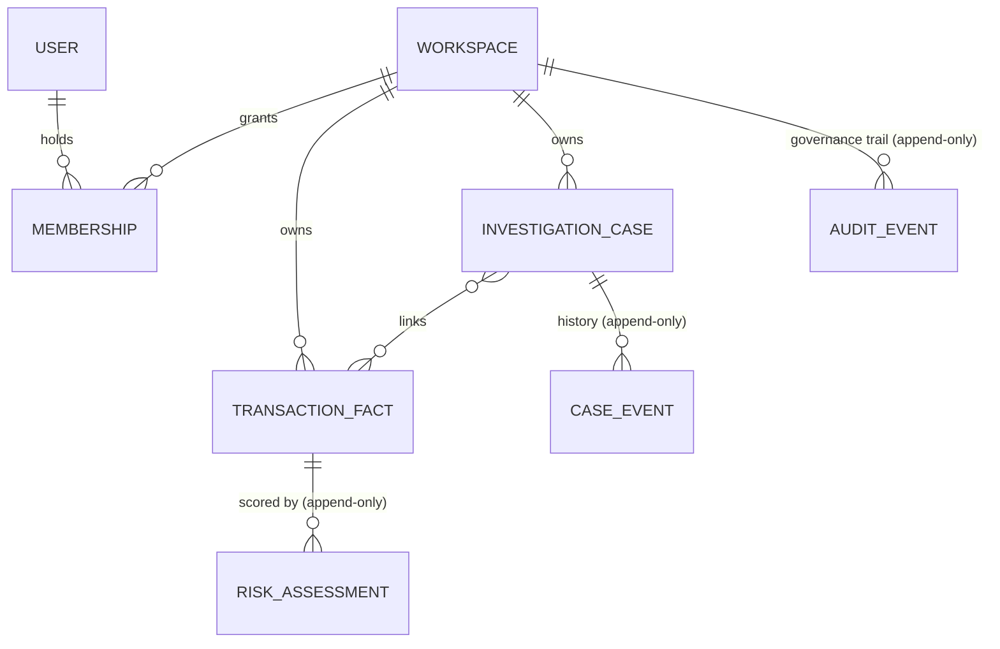

# LayerNet Data Contract v1 and Persistence Design

**Status:** APPROVED DESIGN (D5 retention open) — design and executable contract only. No database, server repository, migration, or API has been implemented.
**Date:** 2026-11-27 · **Phase:** 2 (P1 backend architecture)
**Executable contract:** `lib/domain/contracts.ts` (zod schemas) and `lib/domain/legacyImport.ts`, tested in `lib/domain/__tests__/contracts.test.ts`.
**Relationship to earlier docs:** supersedes the "Proposed future schema" table in `docs/audit-document-pack-2026-11-10/BACKEND_SCHEMA.md` §10, which is left unchanged as a historical record.

---

## 1. Current-state findings that shape the design

| # | Finding | Evidence | Consequence |
|---|---|---|---|
| F1 | The local record stores the risk result inside the transaction (`riskScore`, `risk`, `status`). | `lib/types.ts` `Transaction` | Facts and assessments must be split. |
| F2 | Saving upserts by `transactionId`, so re-analysing a transaction **overwrites its previous assessment**. | `lib/transactionStorage.ts` `save()` | Violates "historical assessments are never silently rewritten". Server design makes assessments append-only. |
| F3 | `status: "Reviewed"` is derived from the rules decision `Review` (`app/analysis/page.tsx:116`). It reads as if a person reviewed the transaction; nobody did. | `app/analysis/page.tsx` | Misleading label. The contract maps it to an assessment decision only. UI wording fix is queued for Phase 3. |
| F4 | The scoring method/version, scoring time, and input are not stored in history. | `lib/transactionStorage.ts` decoder | Legacy imports are marked `version: "unrecorded-legacy"`, `assessedAt: null`, `inputSha256: null` — not guessed. |
| F5 | No currency is captured anywhere. | `lib/types.ts`, analysis form | Server contract requires ISO 4217 currency; legacy imports carry `null`. |
| F6 | `accountId` is free text typed by the user. | analysis form | It is `accountRef` (transaction-domain), never an identity or ownership proof. |

## 2. Domain model

| Entity | Purpose | Mutability |
|---|---|---|
| Workspace | Tenant and ownership boundary | Rename only |
| User | Authenticated principal, keyed by OIDC `issuer` + `subject` | Profile fields; disable instead of delete |
| Membership | User's role in a workspace | Grant/revoke, each audited |
| TransactionFact | Facts of one financial event + provenance | **Immutable**; corrections are new facts |
| RiskAssessment | One scoring of one transaction by one rules/model version | **Immutable**; re-score = new row |
| InvestigationCase | Analyst workflow over ≥1 transactions | Status/assignee change only via CaseEvents |
| CaseEvent | Who did what to a case, and when | **Append-only** |
| AuditEvent | Imports, exports, deletions, access changes, sessions | **Append-only** |

## 3. Invariants (all enforced in the schemas and covered by tests)

1. A rules assessor can only produce `uncalibrated-heuristic` scores.
2. `calibrated-probability` requires a `calibrationRef` and a 0–1 scale; nothing else may carry a calibration reference.
3. A score must lie inside its declared `scoreScale`.
4. A non-legacy assessment must have `assessedAt` and `inputSha256`; `assessedAt ≤ recordedAt`.
5. A model assessment must carry the artifact's SHA-256 (ties live inference to a verified artifact).
6. `mode: "shadow"` assessments are recorded but may not drive the displayed decision — this is how a model is trialled before it affects users.
7. A case has `closedAt` and a `disposition` exactly when `status = closed`; status changes follow an explicit transition table; a transaction links to a case at most once.
8. Only a case **disposition** (`confirmed_fraud` / `not_fraud` / `inconclusive`) is a human judgement. Scores, model outputs, and AI assistance never become labels.
9. AI assistance is recorded as an `ai_assist_used` event listing which transactions were shared with the provider — not as evidence.
10. Currency is mandatory except for legacy local imports.
11. Audit `details` are small scalars only — no secrets, prompts, or raw identifiers.

## 4. Authorization (proposed default — requires approval)

Server-side, per request, per workspace. The UI may hide controls but is never the enforcement point.

| Permission | viewer | analyst | lead | admin |
|---|:-:|:-:|:-:|:-:|
| transaction / assessment / case read | ✓ | ✓ | ✓ | ✓ |
| transaction & assessment create, case create/comment, AI assist | | ✓ | ✓ | ✓ |
| case assign / close, data export, audit read | | | ✓ | ✓ |
| data import, data delete, manage members | | | | ✓ |

## 5. Database options

No prices are quoted: they depend on a hosting choice that has not been made.

| Criterion | PostgreSQL | SQLite | Document DB (e.g. MongoDB) |
|---|---|---|---|
| Relational integrity (fact → assessment → case links) | Strong: FKs, CHECK, unique `(workspace_id, source_transaction_id)` | Strong in one file | Weak: application-enforced |
| Append-only enforcement | Revoke UPDATE/DELETE from the app role + triggers | Triggers only; no roles | Application-enforced |
| Tenant isolation | Row-Level Security per `workspace_id` | None (single file) | Application-enforced |
| Concurrency / multiple app instances | Yes | Single writer; one host only | Yes |
| Analytics queries (counts, trends, joins) | Strong SQL + indexes | Adequate at small scale | Aggregation pipeline |
| Flexible fields (factors, limitations, event payloads) | JSONB | JSON functions | Native |
| Python/ML compatibility | psycopg / SQLAlchemy / `pandas.read_sql` | stdlib `sqlite3` | pymongo |
| Backup / point-in-time recovery | Mature (base backup + WAL, or managed PITR) | File copy | Mature (managed) |
| Hosting flexibility | Self-hosted, container, or any managed provider | Local disk only | Self-hosted or managed |
| Migration complexity from current code | Moderate | Low | Moderate |

**Recommendation: PostgreSQL.** It is the only option that enforces the invariants that matter most here at the database level: immutable assessments, append-only audit history, and per-workspace isolation. Keeping them out of application code alone means one bug can't silently rewrite history. SQLite is acceptable for a single-user local demo but cannot provide tenant isolation or multi-instance safety, so it would have to be replaced before any shared deployment. A document database gives up the relational integrity this domain depends on.

Data access: a thin repository layer over SQL migrations (e.g. a typed query builder or plain parameterized SQL), with the zod schemas validating every row crossing the boundary. ORM choice is deferred to implementation; it is an ordinary, reversible decision.

## 6. Migration path from browser-local history

1. **Now (unchanged):** `LocalStorageTransactionRepository` keeps working. Local-only mode stays the default until auth and persistence exist.
2. **Split the repository interface** into `TransactionFactRepository`, `RiskAssessmentRepository`, `CaseRepository`, with the local adapter implementing the subset it can.
3. **Server adapter** implements the same interfaces against PostgreSQL behind authenticated, workspace-scoped API routes.
4. **Explicit import, never automatic:** the user picks records, previews the mapping (`mapLegacyLocalRecord`), and confirms. Each run gets an `importBatchId` and a `data.imported` AuditEvent with counts.
   - De-duplication on `(workspaceId, sourceTransactionId)`; conflicts are reported and skipped, never merged or overwritten.
   - Records failing the contract are listed with the reason and not imported.
   - **Rollback:** delete by `importBatchId` (an admin-only, audited `data.deleted` action).
   - The browser copy is left untouched; the user decides separately whether to clear it.
5. **Re-scoring** an imported transaction creates a new, fully-provenanced assessment; the legacy one remains.

## 7. Decisions that need your approval

**2026-11-27:** the project owner approved the recommended defaults for D1–D4 and D6–D10. D5 remains open.

| # | Decision | Default | Status |
|---|---|---|---|
| D1 | Database | PostgreSQL (§5) | APPROVED |
| D2 | Tenancy | Multi-workspace schema from day one, even if only one workspace is used initially (cheap now, hard to retrofit) | APPROVED |
| D3 | Role matrix | As in §4 | APPROVED |
| D4 | `accountRef` / `deviceRef` handling | Pseudonymize at ingest with a keyed HMAC (server-held secret); never store the raw value | APPROVED |
| D5 | Retention periods for facts, assessments, cases, audit events | **No default proposed.** This depends on the owner's legal and academic context; no duration is invented here. | **OPEN — needs owner input** |
| D6 | Deletion model | Admin-only, audited hard delete of facts/assessments within a workspace; audit events kept for their own retention period | APPROVED |
| D7 | AI chat content storage | Do not store prompts/responses server-side; record only the `ai_assist_used` event and which transactions were shared | APPROVED |
| D8 | Export format | CSV and JSON per workspace, admin/lead only, audited | APPROVED |
| D9 | Backup targets (RPO/RTO) | To be set with the hosting decision | APPROVED (deferred to hosting) |
| D10 | Legacy currency | Import as `null` (unknown) rather than assume a currency | APPROVED |

## 8. Explicitly not done

No database, schema migration, server repository, CRUD API, authentication, case UI, or import UI exists yet. The contract is not yet used by the running application. This is intentional, until D1–D10 are decided.
